# OwnShop AI user manual

OwnShop AI answers your customers for you. It works with WhatsApp, Telegram and your website. It runs on your own Windows computer or Mac. Customers ask for products, place orders, pick a delivery slot and get an invoice and a receipt. You see every order in your browser.

The screenshots come from a demo shop called Green Leaf Organics. Folder paths are hidden in them. For step-by-step guides with more detail, see the [Manual](/manual/).

## Contents

1. [Install](#1-install)
2. [First setup](#2-first-setup)
3. [Connect WhatsApp](#3-connect-whatsapp)
4. [Connect Telegram](#4-connect-telegram)
5. [Products](#5-products)
6. [Shops that sell services](#6-shops-that-sell-services)
7. [Payment methods](#7-payment-methods)
8. [Orders and Payment received](#8-orders-and-payment-received)
9. [Users page](#9-users-page)
10. [Web chat for testing](#10-web-chat-for-testing)
11. [Test from the command line](#11-test-from-the-command-line)
12. [Start over](#12-start-over)
13. [Troubleshooting](#13-troubleshooting)
14. [Put your chat on the web](#14-put-your-chat-on-the-web)

## 1. Install

1. Download `ownshop-setup-windows-amd64.exe` (or `-arm64.exe`) (about 700 MB; it holds the program and the AI model).
2. Double-click it.

There is no wizard. A black window opens while the files are copied to `%LOCALAPPDATA%\ownshop`. Then OwnShop AI starts and opens the shop page in your browser at `http://127.0.0.1:2007`. Leave the black window open: it belongs to the running shop.

The setup also:

- adds OwnShop AI to the Start menu,
- puts an `OwnShop AI` shortcut on the desktop that opens the shop page,
- makes OwnShop AI start when you log in.

Your shop's data (orders, products file, photos, settings) lives in `%APPDATA%\ownshop`. Installing again keeps it.

To remove the program, run the setup file you downloaded with `/uninstall`, for example `ownshop-setup-windows-amd64.exe /uninstall`. Your shop's data stays in `%APPDATA%\ownshop`.

## 2. First setup

Setup has four steps. You can go back to any step from the row of buttons at the top.

### Step 1: Shop

Type your shop name and currency (INR by default). Choose **Products** (things you sell and deliver) or **Services** (appointments people book). A shop sells one or the other, not both. Click **Next**.

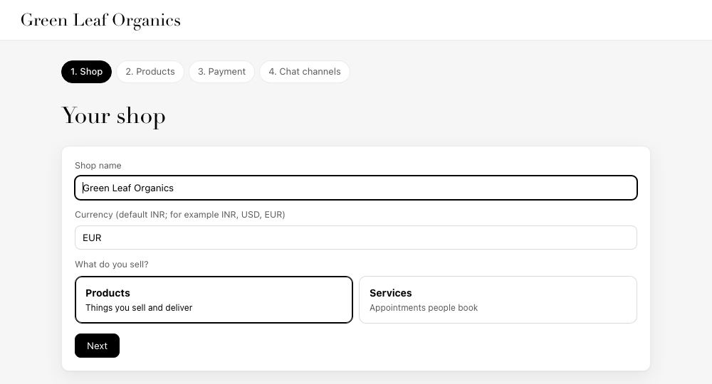

### Step 2: Products

Click **Choose File**, pick your Excel file and click **Upload and next**. Not sure what the file looks like? Click **Download the example file**, change it and upload it. See [Products](#5-products) for the columns.

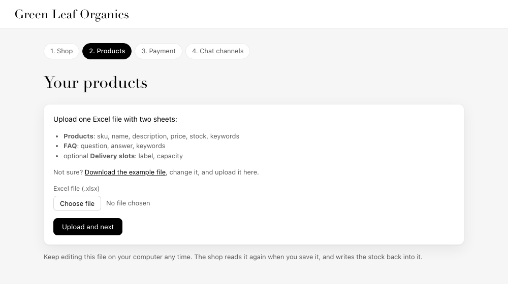

After the upload, the next page says how many products and questions were read and where your file is kept.

### Step 3: Payment

Pick one way to be paid: **UPI**, **QR code image**, **Payment link** or **Bank transfer**. Only the field for that choice is shown. For UPI, type your UPI ID (the demo uses the made-up `greenleaf@upi`). Click **Next**, or **Skip for now**. You can add more ways to pay later.

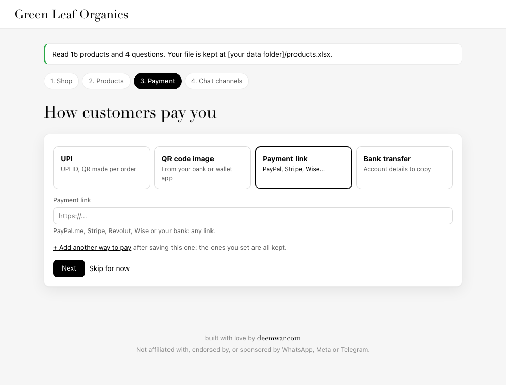

### Step 4: Chat channels

Here you connect WhatsApp and Telegram. The web chat for test customers is always on. In this run WhatsApp was already linked, so it shows **connected**.

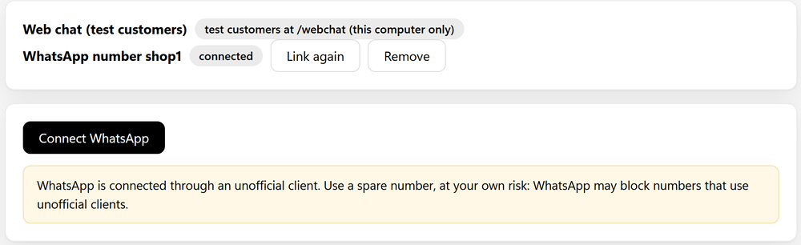

Scroll down and click **Finish**. The Orders page opens with "Your shop is ready".

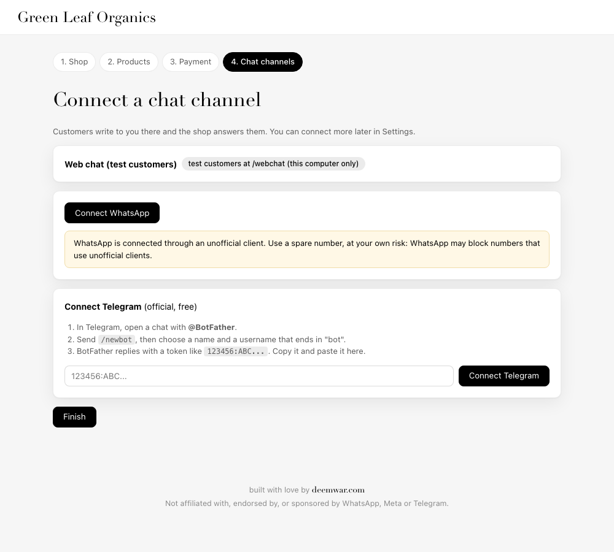

## 3. Connect WhatsApp

Use a spare WhatsApp number. OwnShop AI links to WhatsApp through an unofficial client, and WhatsApp may block numbers that use unofficial clients. The page shows this warning too.

1. In step 4 of setup, or in **Settings**, click **Connect WhatsApp**.
2. A QR code appears on the page.
3. On the phone with the spare number, open WhatsApp, go to **Linked devices**, tap **Link a device** and scan the code.
4. The page shows "Linked. Finishing setup..." and then **connected**. The code refreshes by itself if it runs out before you scan it.

Each linked number has **Link again** and **Remove** buttons. Removing a number does not touch your orders.

## 4. Connect Telegram

Telegram is official and free.

1. In Telegram, open a chat with `@BotFather`.
2. Send `/newbot`, then choose a name and a username that ends in `bot`.
3. BotFather replies with a token like `123456:ABC...`. Paste it into the box and click **Connect Telegram**.

## 5. Products

Your products live in one Excel file with these sheets:

| Sheet | Columns |
|---|---|
| Products | sku, name, description, price, stock, keywords |
| FAQ | question, answer, keywords |
| Delivery slots (optional) | label, capacity |

After the upload, OwnShop AI keeps the file at `%APPDATA%\ownshop\products.xlsx`. Edit it there and save; the shop reads it again by itself. You can also click **I updated my file**, or upload a different file with **Replace with another file**. Stock goes back into the file after each order.

**Photos.** Put an image named after the product's sku in `%APPDATA%\ownshop\images`, for example `HON-500.png` for the product with sku `HON-500`. Or upload a photo for each row on the Products page. Customers see the photo when they search, when they add the item, and on the invoice.

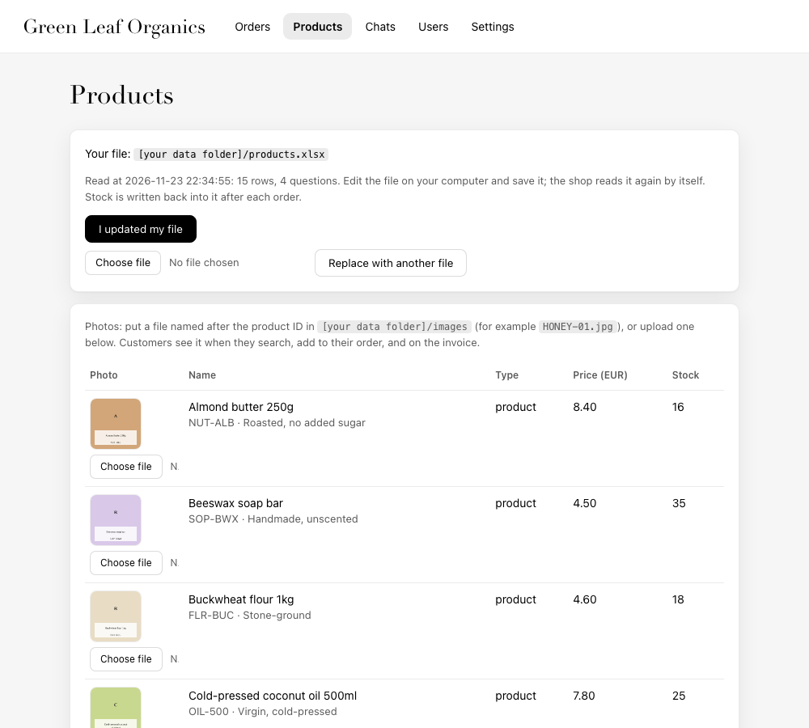

The catalog in chat shows up to 20 items, then tells the customer to ask for an item by name.

## 6. Shops that sell services

Choose **Services** in step 1. Instead of a file upload, setup asks what kind of business you run (Clinic / Doctor, Salon / Beauty, Tuition / Classes, Repair / Home service, Consultant, or Other). Each type fills in a usual service, opening hours and slot length. Change anything, then click **Looks good, continue**. Customers can then write things like `book Haircut` and pick a day and time. Bookings show on the Calendar page.

## 7. Payment methods

Setup asks for one way to be paid. In **Settings** you see every method you set, each with **Edit** and **Remove**, and **+ Add another way to pay**.

- **UPI**: each order gets its own UPI QR code with the amount and order number filled in.
- **QR code image**: upload the QR image from your bank or wallet app.
- **Payment link**: a PayPal, Stripe, Wise or similar link.
- **Bank transfer**: account details the customer can copy.

The payment details go to the customer with the total. You click **Payment received** when the money arrives.

## 8. Orders and Payment received

Every order appears on the **Orders** page with the customer, the delivery slot, the items and the total. The same list is kept in `%APPDATA%\ownshop\orders.csv` (opens in Excel); **Download** gives you a copy.

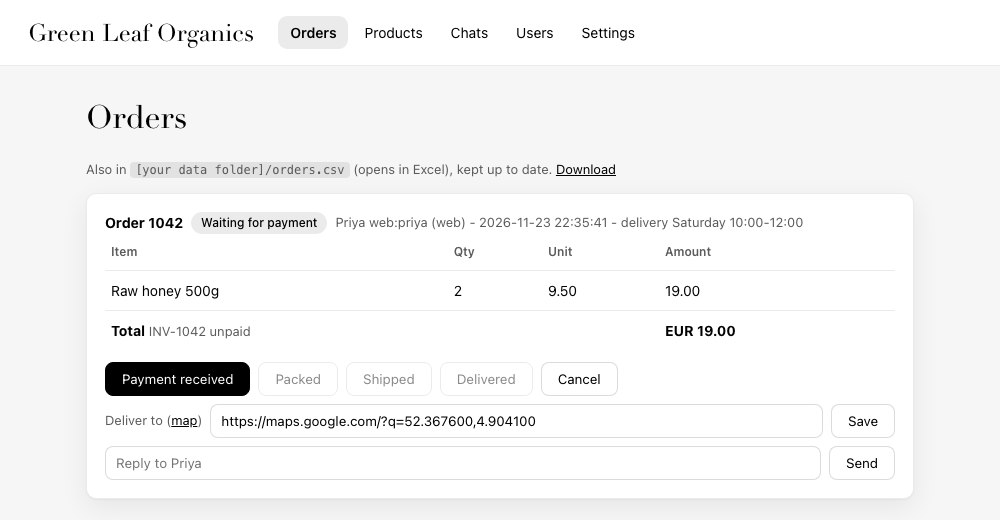

When the money arrives, click **Payment received**. OwnShop AI marks the invoice paid and sends the customer a receipt with a thank-you message. Then use **Packed**, **Shipped** and **Delivered** as the order moves, or **Cancel**.

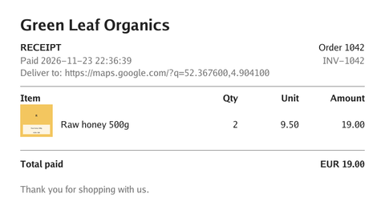

## 9. Users page

The **Users** page has two parts.

**Test customers (web chat).** Add a made-up email or phone, a password and, if you like, a display name, then click **Add**. That test customer can log in to the web chat on this computer. **Delete** removes them.

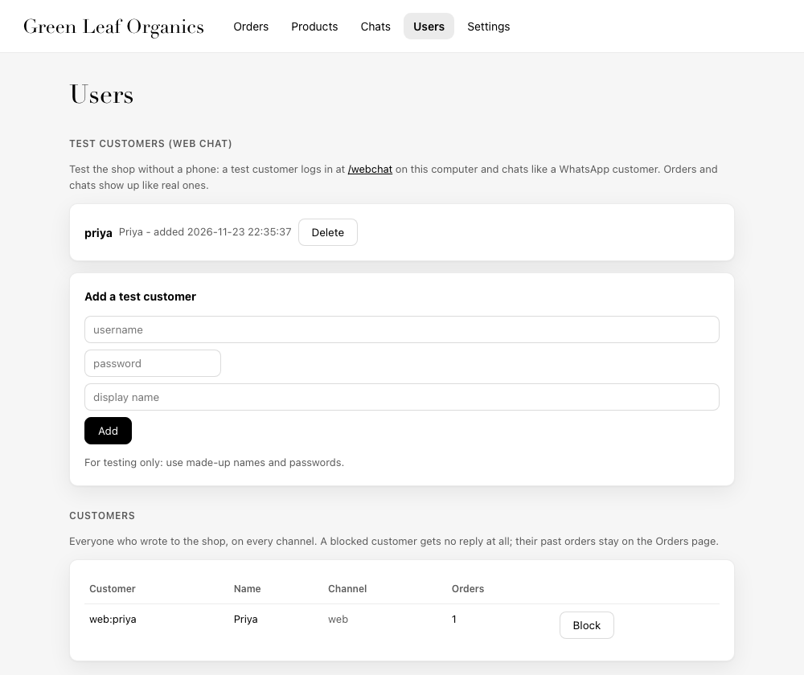

**Customers.** Everyone who wrote to the shop, on every channel. Click **Block** to stop all replies to that customer on every channel. Their past orders stay on the Orders page. **Unblock** undoes it.

## 10. Web chat for testing

Test the shop without a phone. Open `http://127.0.0.1:2007/webchat` on the same computer and log in as a test customer. The web chat only works on this computer.

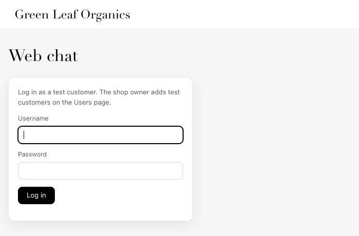

You chat like a WhatsApp customer, with the same bot. Orders and chats show up like real ones.

A typical order:

1. `do you have honey` (the shop lists matching products with photos)
2. `add 2 raw honey`
3. pick a delivery slot, for example `slot 1`
4. `yes` to confirm the order
5. share the delivery location: **Share location** uses the browser's location, or type `lat,lng` (for example `52.3676,4.9041`) and click **Send location**

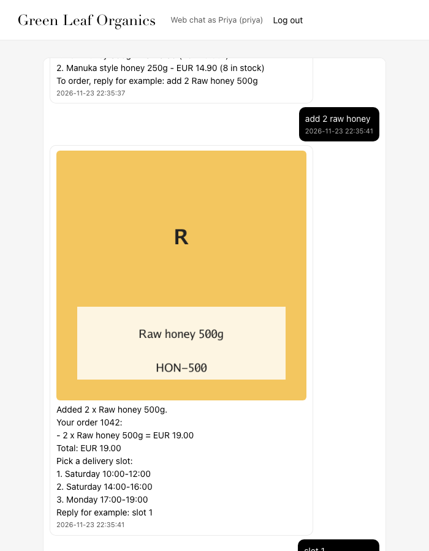

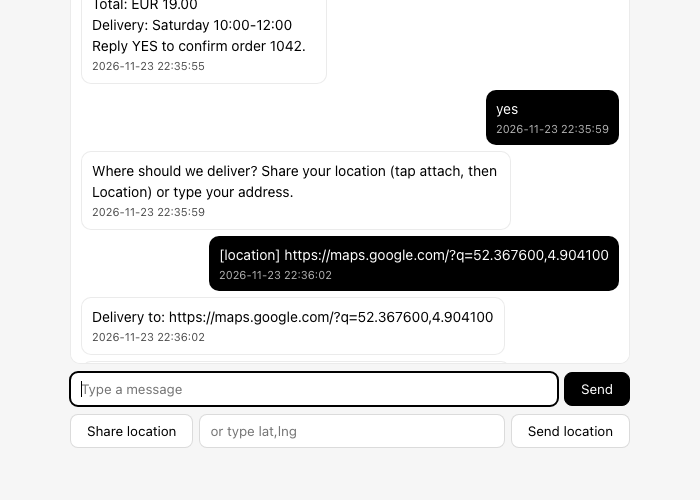

## 11. Test from the command line

The program is at `%LOCALAPPDATA%\ownshop\ownshop.exe`. The shop's database is `%APPDATA%\ownshop\ownshop.db`. The `webuser` and `user` commands use `ownshop.db` in the current folder unless you pass `--db`, so run them like this:

```bat
cd /d "%APPDATA%\ownshop"
"%LOCALAPPDATA%\ownshop\ownshop.exe" webuser add priya@example.com demo123 --name Priya
"%LOCALAPPDATA%\ownshop\ownshop.exe" webuser list
"%LOCALAPPDATA%\ownshop\ownshop.exe" webuser delete priya@example.com
"%LOCALAPPDATA%\ownshop\ownshop.exe" user list
"%LOCALAPPDATA%\ownshop\ownshop.exe" user block web:priya@example.com
"%LOCALAPPDATA%\ownshop\ownshop.exe" user unblock web:priya@example.com
```

`ownshop say` chats as a test customer with the running shop and prints each reply. It stops when the shop has been quiet for 3 seconds, and gives up after 60 seconds. It exits with an error if something fails.

```bat
"%LOCALAPPDATA%\ownshop\ownshop.exe" say --user priya@example.com --password demo123 "do you have honey"
"%LOCALAPPDATA%\ownshop\ownshop.exe" say --user priya@example.com --password demo123 --location 52.3676,4.9041
```

Add `--url http://127.0.0.1:2007` if the shop runs on another address.

## 12. Start over

Find **Start over** at the bottom of each page, or in **Settings**. Both choices save a backup first in `%APPDATA%\ownshop\backups`. To confirm, type the shop name or `CLEAR`.

- **Clear test data** deletes every order, customer, chat message, hand-off, booking and blocked slot, and the invoice and receipt images. Order numbers start again at 1042. Products, photos, settings, payment details, WhatsApp and Telegram are kept.
- **Delete this shop and start a new one** deletes everything in the shop, including products, photos, the payment QR, settings and test customers, and takes you back to step 1. WhatsApp and Telegram stay connected unless you tick **Also disconnect WhatsApp and Telegram**.

## 13. Troubleshooting

**The first reply is slow.** The AI model loads when the shop starts. The first question that needs the model can take a minute; later replies take a few seconds. Greetings, the catalog, opening hours, prices and similar common questions are answered without the model, so they are instant. A slow computer that is also busy with other heavy work (for example screen recording) is slower still.

**Windows SmartScreen says "Windows protected your PC".** Click **More info**, then **Run anyway**. It appears for programs Windows does not know yet.

**The browser did not open.** Double-click the `OwnShop AI` shortcut on the desktop, or open `http://127.0.0.1:2007`.

**A customer gets no reply.** Check the **Users** page: a blocked customer gets no reply on any channel. Check that WhatsApp shows **connected** in **Settings**.

**I edited the products file and nothing changed.** Save the file and wait a few seconds, or click **I updated my file** on the Products page. If the file has a problem, the Products page says what is wrong.

## 14. Put your chat on the web

Customers chat with your shop in any browser through a public link. No website or domain needed; your shop page stays on this computer only. Full guide: [Put your chat on the web](guides/14-web-chat-link.md).

1. Install Cloudflare's free tunnel program once: Windows `winget install --id Cloudflare.cloudflared`, Mac `brew install cloudflared`, or download it from https://developers.cloudflare.com/cloudflare-one/connections/connect-networks/downloads/. Then click **Check again** on the **Website (your own public chat link)** card in Settings > Chat channels.
2. Get your free link `yourname.ownshopai.store`: **Sign in with Google**, pick a name, **Get my link**, then **Make my web chat public**. It stays the same after a restart. While the link service cannot be reached, the card says **Coming soon**.
3. Share the link or its QR code. The Orders page shows it too. **Stop** takes it offline; if it was on, it starts again by itself when OwnShop AI starts.
4. Customers type a phone number or email (name optional, no password). The browser remembers them. They can add the chat to the home screen and turn on notifications for replies (on iPhone after adding it to the home screen, iOS 16.4 or later).
5. The Users page lists web customers with name, phone ("web, phone not verified"), first and last visit, and Block.

Limits: the computer must stay on; Cloudflare carries and can see the traffic; phone numbers are not checked; each browser is its own customer and is never merged with WhatsApp or Telegram.

