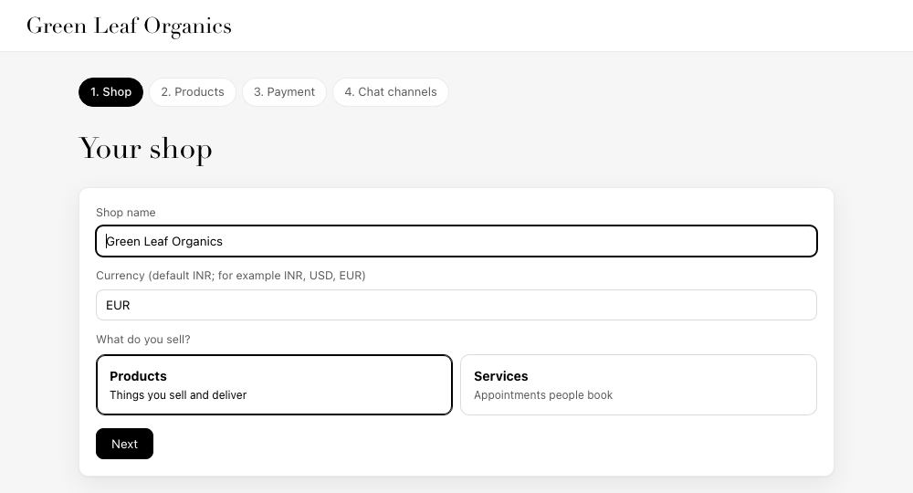
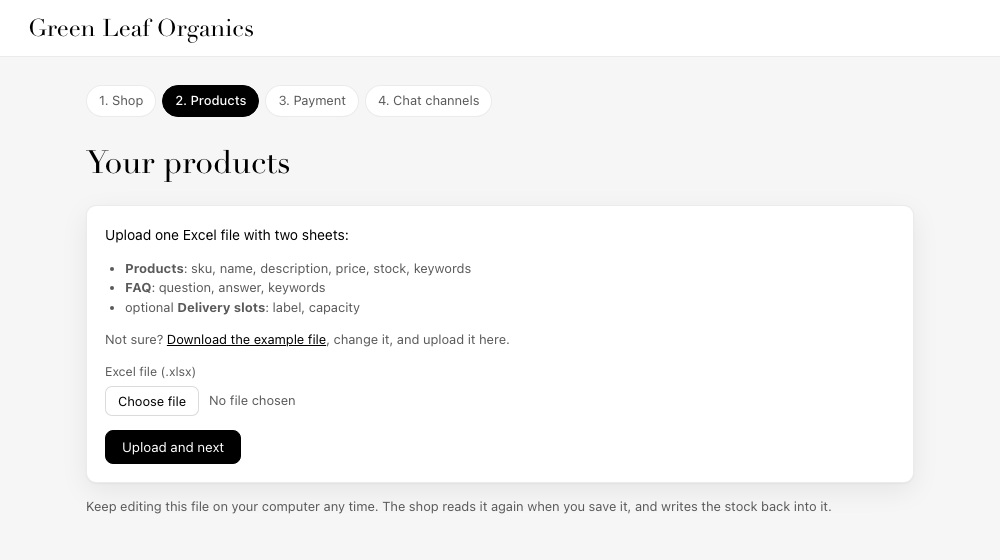
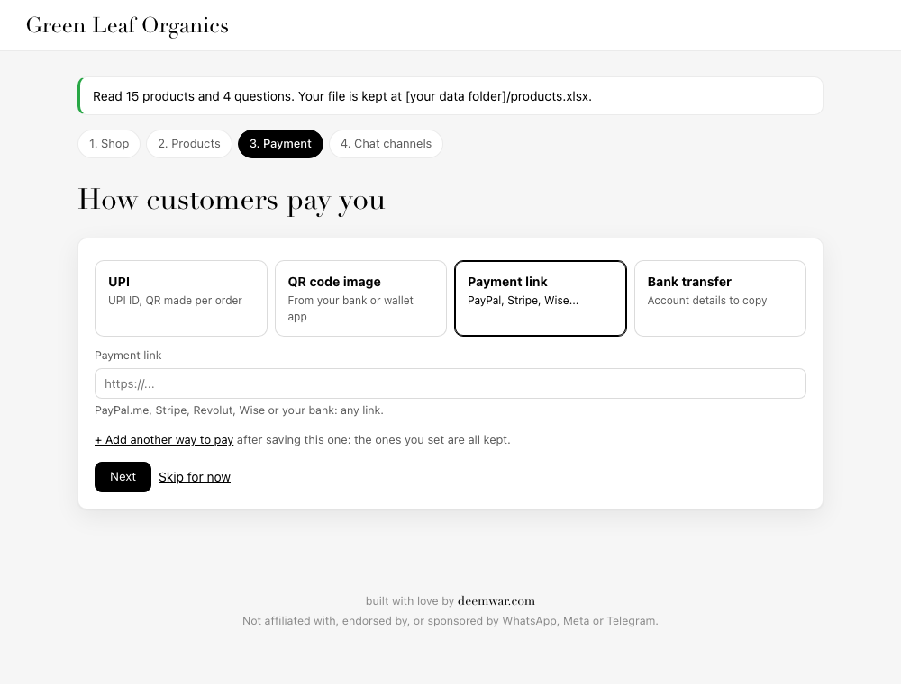
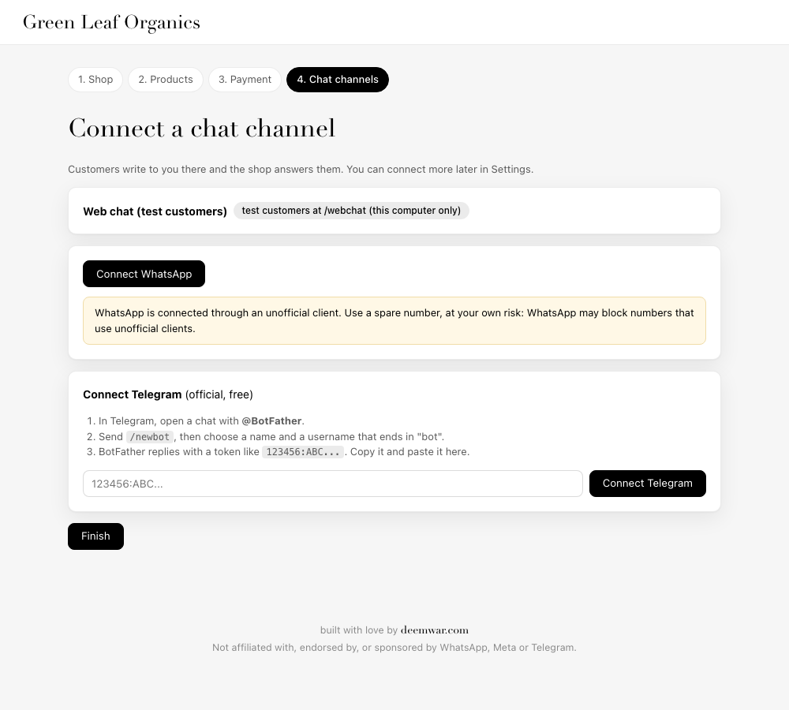

# First setup

Four short steps in the browser: your shop, what you sell, how you get paid, and where customers reach you. About five minutes.

The steps are shown as buttons at the top of the page: **1. Shop**, **2. Products** (or **2. Services**), **3. Payment**, **4. Chat channels**. You can go back to a step you finished by clicking it.

## Step 1: Your shop

1. **Shop name.** Type the name customers should see, for example `Green Leaf Organics`. It appears in replies, on invoices and on receipts.
2. **Currency.** Type a currency code such as `USD`, `EUR`, `GBP` or `INR`. It is printed next to every price. If you leave it empty, INR is used.
3. **What do you sell?** Pick **Products** (things you sell and deliver; customers order items and pick a delivery slot) or **Services** (appointments people book, such as a haircut, a class or a consultation).
4. Click **Next**.

A shop sells products or services, not both. You can change this later in **Settings**.

## Step 2: Products or services

- **Products:** you upload one Excel file with your products. See [Add products from Excel](/manual/products-excel/) for the exact columns. Not ready yet? Click **Download the example file**, upload it as it is, and replace it later.
- **Services:** you pick your kind of business and set your hours. See [Services and bookings](/manual/services-bookings/).

After the upload, the next page says how many products and questions were read, and where your file is kept.

## Step 3: How customers pay you

Pick one way to be paid now. You can add more later.

1. Click one of the four cards: **UPI**, **QR code image**, **Payment link** or **Bank transfer**. Only the field for that card is shown.
2. Fill it in, for example a PayPal or Stripe link for **Payment link**.
3. Click **Next**, or **Skip for now** if you want to do this later.

The details of each method are in [Payment methods](/manual/payments/).

## Step 4: Chat channels

Here you connect WhatsApp, Telegram, or both. The web chat for test customers is always on, so you can finish without connecting anything and test first.

- WhatsApp: see [Connect WhatsApp](/manual/whatsapp/).
- Telegram: see [Connect Telegram](/manual/telegram/).

Click **Finish**. The **Orders** page opens with "Your shop is ready. New orders show up here."

## What you should see after setup

A menu at the top of every page: **Orders**, **Products** (or **Calendar** and **Services** for a services shop), **Chats**, **Users** and **Settings**. Everything you chose in setup can be changed in **Settings**.

## If it goes wrong

- **The upload says a row is wrong.** The message names the sheet and row, for example "Products row 4: price "abc" is not a number". Fix that cell in Excel, save, and upload again.
- **I picked the wrong type (products or services).** Change **What do you sell?** in **Settings** and click **Save**.
- **I want to start again from step 1.** Use **Delete this shop and start a new one** in [Start over](/manual/start-over/).
