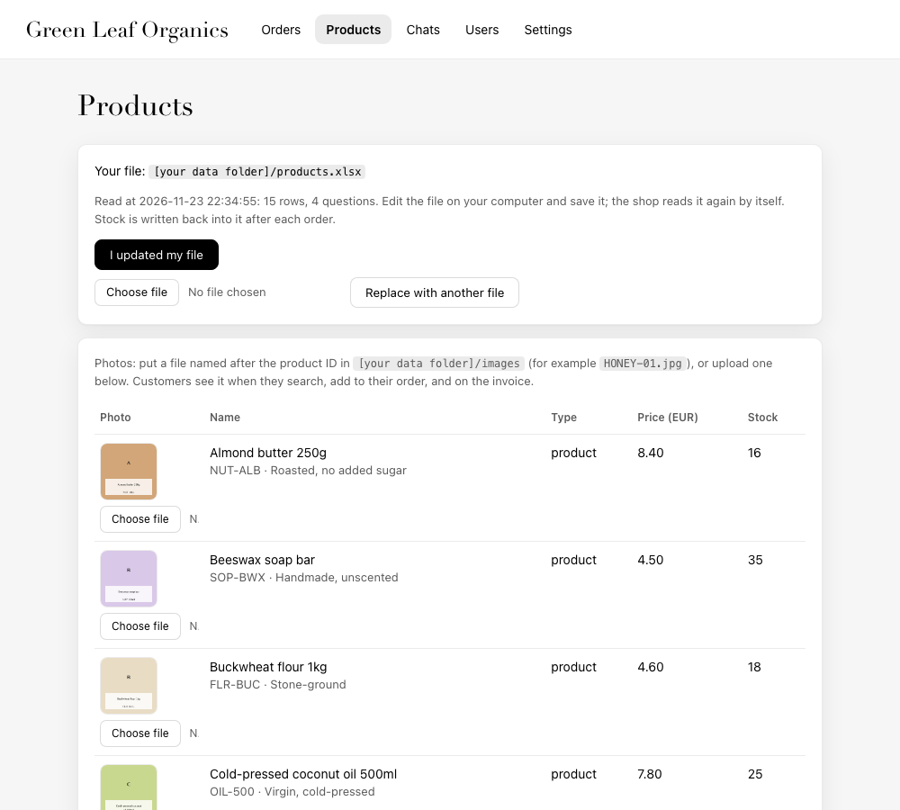

# Add products from Excel

Your products, prices, stock and your own questions and answers live in one Excel file. Edit it in Excel any time; the shop reads it again when you save.

## 1. Get the example file

On setup step 2, click **Download the example file**. It is `products.xlsx` with 15 demo products, 4 questions and 3 delivery slots. Change it into your own list and keep the sheet names and column headers as they are.

## 2. The sheets and columns

The file has up to three sheets. Column headers go in the first row. Upper or lower case does not matter, and the columns can be in any order.

**Products** (required). If no sheet is called `Products`, the first sheet is used.

| Column | What to put in it |
|---|---|
| `sku` | Your product code, for example `HON-500`. Used for the photo file name. |
| `name` | Required. The product name customers see, for example `Raw honey 500g`. Each name once. |
| `description` | A short line shown with the product. |
| `price` | Required. A number, for example `9.50` (`9,50` works too). No currency sign. |
| `stock` | How many you have. The shop lowers it after each order and writes it back into the file. |
| `keywords` | Words customers might use, separated by commas, for example `honey, raw, sweet`. Add words in other languages here too. |
| `type` | Optional. `product` (default) or `service`. |
| `minutes` | Optional. For a service: how long it takes. |

**FAQ** (optional): your own questions and answers.

| Column | What to put in it |
|---|---|
| `question` | For example `Where do you deliver?` |
| `answer` | The exact answer the shop sends. |
| `keywords` | Words that should trigger this answer, for example `deliver, delivery, area, shipping`. |

A row needs both a question and an answer. When the FAQ sheet is in the file, it replaces all earlier questions.

**Delivery slots** (optional): times customers can pick for delivery.

| Column | What to put in it |
|---|---|
| `label` | What the customer sees, for example `Saturday 10:00-12:00`. |
| `capacity` | How many orders fit in that slot. Empty or not a number means 10. |

## 3. Upload it

1. On setup step 2, click **Choose File**, pick your file, and click **Upload and next**.
2. Later, on the **Products** page, use **Replace with another file** to upload a different file.

The shop keeps its own copy of the file in your data folder and shows the path on the **Products** page (**Your file: ...**). That copy is the one to edit from now on.

## 4. Edit and save

1. Open the file shown on the **Products** page in Excel.
2. Change prices, stock, names or add rows. Save.
3. The shop reads it again by itself within a few seconds. To force it, click **I updated my file**.

The Products page shows when the file was read and how many rows and questions it found.

- A product you delete from the file stops being sold. Its past orders stay.
- Rows are matched by **name**. Renaming a product makes it a new product.
- If the file is open in Excel when an order comes in, the new stock is written back after you close it.

## 5. Add photos

Two ways, use either:

- **By file name.** Put a photo named after the product's `sku` into the `images` folder next to your products file, for example `HON-500.jpg` for sku `HON-500`. `.jpg`, `.jpeg`, `.png` and `.webp` work, in any letter case.
- **On the Products page.** Click **Choose File** in the Photo column of that row and pick a photo. It uploads right away.

Customers see the photo when they search, when they add the item, and on the invoice.

## If it goes wrong

The Products page shows the problem in a yellow box. The usual ones:

- **"the Products sheet has no products"**: the sheet is empty or the header row is missing.
- **"Products row 5: name is empty"**: fill in the name in that row (the row number counts the header as row 1).
- **"Products row 5: price "..." is not a number"**: remove currency signs and text from the price.
- **"the Products sheet needs name and stock columns"**: a header was renamed. Use the exact words from the tables above.
- **A photo does not show.** Check that the file name matches the sku exactly (`HON-500.jpg`, not `HON 500.jpg`) and that it is a real image.
