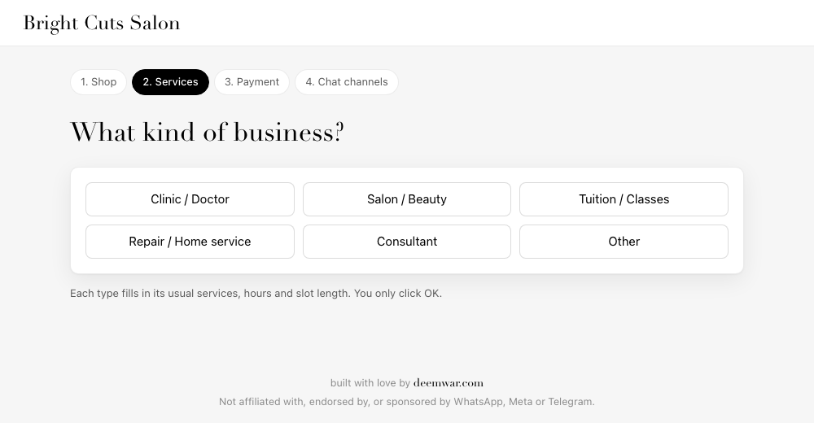
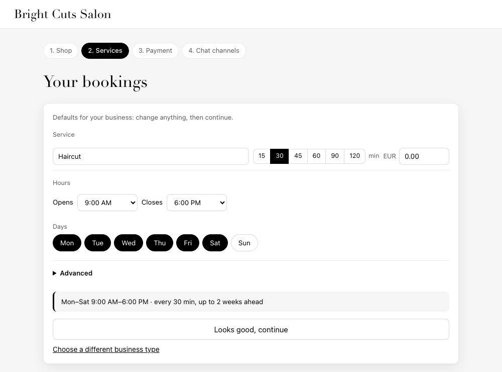
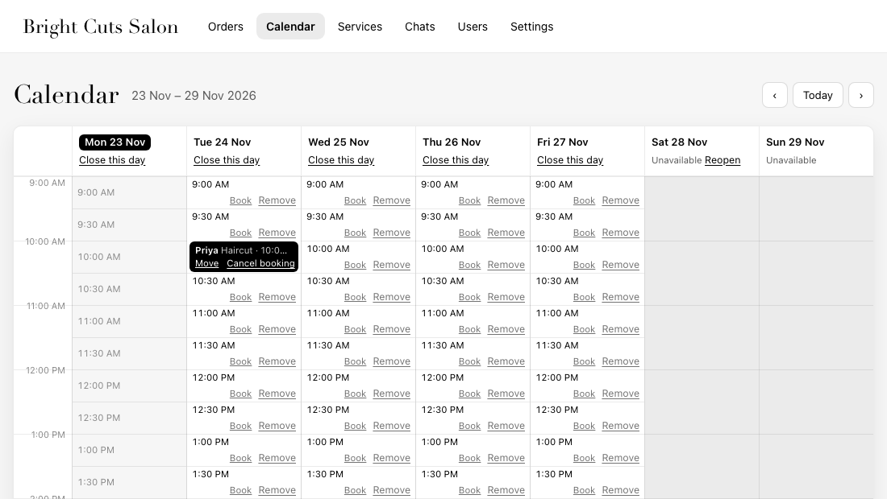
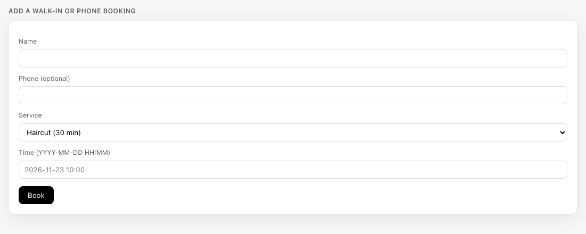
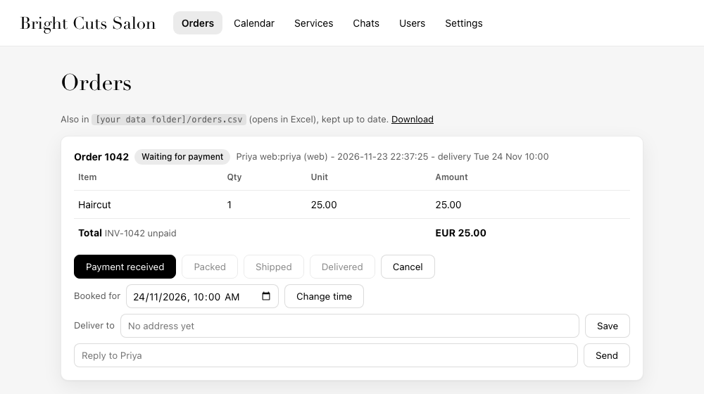

# Services and bookings

For shops that sell time instead of goods: salons, tutors, clinics, repair visits, consultants. Customers book a day and time in chat, and you see every booking on the Calendar page.

## 1. Choose Services in setup

1. On setup step 1, pick **Services** under **What do you sell?** and click **Next**.
2. Pick your kind of business. Each one fills in a usual service, hours and slot length:

| Business type | Service it adds | Days and hours |
|---|---|---|
| Clinic / Doctor | Consultation, 30 min | Mon-Sat, 09:00-18:00 |
| Salon / Beauty | Haircut, 30 min | Mon-Sat, 09:00-18:00 |
| Tuition / Classes | Class, 60 min | Mon-Sat, 16:00-20:00 |
| Repair / Home service | Visit, 60 min | Mon-Sat, 09:00-18:00 |
| Consultant | Call, 30 min | Mon-Sat, 09:00-18:00 |
| Other | Appointment, 30 min | Mon-Sat, 09:00-18:00 |

All types start with 30-minute slots and bookings up to 2 weeks ahead.

## 2. Check the defaults

The **Your bookings** page shows what the type filled in. Change anything:

1. **Service**: the name, the length (15 to 120 minutes) and the price. The price starts at 0, so type yours.
2. **Hours**: **Opens** and **Closes**.
3. **Days**: click a day to switch it on or off.
4. The grey line at the bottom sums it up, for example "Mon-Sat 9:00 AM-6:00 PM · every 30 min, up to 2 weeks ahead".
5. Click **Looks good, continue**. Picked the wrong type? Click **Choose a different business type**.

## 3. Advanced settings

Click **Advanced** on the same page (or in **Settings** later) for:

- **More services**: **+ Add service** for each extra service, with its own length and price.
- **Weekly hours**: different hours per day, more than one time range a day (for example a lunch break), and **Copy to all days**.
- **Date overrides**: **+ Add a date override** for a holiday (**Unavailable all day**) or special hours on one date.
- **Slot length**: how far apart the start times are.
- **Customers can book up to**: how far ahead.
- **Minimum notice**: how soon before a time it can still be booked.
- **Time between bookings**: a break after each booking.
- **Most bookings a day**: a daily limit.

## 4. How a customer books

The customer writes for example `book Haircut`. The shop then:

1. lists the next days to pick from,
2. lists the free times on that day,
3. asks the customer to reply YES to confirm,
4. sends the booking with the invoice and how to pay.

Customers can also ask for their booking status, or ask to cancel or move it; those requests come to you.

## 5. The Calendar page

**Calendar** shows one week. Use the arrows and **Today** to move between weeks.

- **Close a day:** click **Close this day** under the date. The day shows **Unavailable**; click **Reopen** to undo.
- **Remove one time:** click **Remove** on a free time. It is taken off that date only and shows **Removed**; click **Restore** to undo.
- **Move a booking:** click **Move** on it, then **Move here** on a free time. **Stop moving** cancels.
- **Cancel a booking:** click **Cancel booking**. The time becomes free and the customer is told.
- **Add a walk-in or phone booking:** click **Book** on a free time, or fill in the form under the calendar (name, phone, service, time) and click **Book**.

Your usual hours stay in **Settings > Bookings (services)**. Closing a day or removing a time only affects that date.

## 6. Bookings on the Orders page

Every booking is also an order on **Orders**, with **Booked for** and **Change time**, and the same payment buttons as products.

## If it goes wrong

- **"Every day is unavailable: switch on at least one day."** Switch on at least one day under **Days** or **Weekly hours**.
- **Customers see no free times.** Check the hours, **Minimum notice**, **Most bookings a day**, and whether the day is closed on the Calendar.
- **The price shows 0.** Type the price under **Service**, or on the **Services** page, and save.
