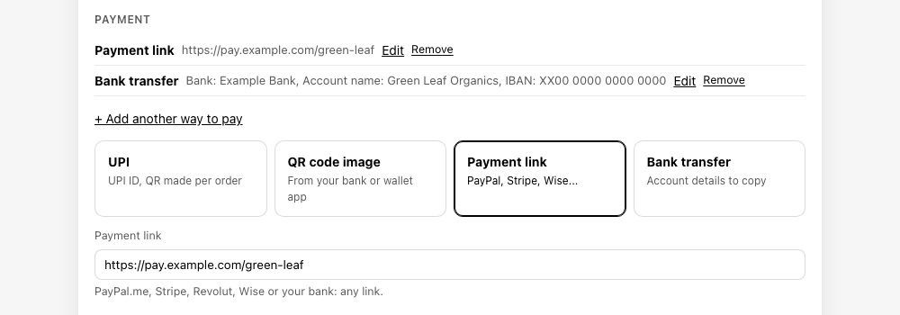
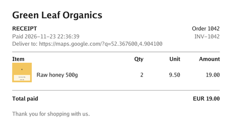

# Payment methods

OwnShop AI never touches money. It sends your payment details with each order, and you click Payment received when the money is there.

## The four ways to be paid

| Method | What you enter | What the customer gets |
|---|---|---|
| **Payment link** | A link that starts with `https://`, for example from PayPal.me, Stripe, Revolut, Wise or your bank. | The link with the amount to pay and the order number. |
| **QR code image** | A `.png` or `.jpg` of the QR code from your bank or wallet app (for example PayNow, PromptPay, Pix, GiroCode). | Your QR image. |
| **Bank transfer** | Account details as text, for example bank, account name and IBAN. | The text to copy, with the order number to put in the reference. |
| **UPI** | A UPI ID. Optionally a different name under **change name**. | A UPI QR code made for that order, with the amount and order number filled in. |

When the currency is INR, setup suggests UPI first; for other currencies it suggests a payment link. You can set several methods; the customer gets all of them.

## 1. Set the first method in setup

1. On setup step 3, click the card for your method.
2. Fill in the field that appears.
3. Click **Next**. **+ Add another way to pay** after saving keeps the one you set and lets you add the next.

## 2. Add, change or remove methods later

1. Open **Settings** and scroll to **Payment**.
2. Every method you set is listed with **Edit** and **Remove**.
3. **+ Add another way to pay** picks a method you have not set yet.
4. Fill in the field and click **Save** at the bottom of the form.

## 3. What the customer sees

After the customer confirms the order, the shop sends the invoice and a message like:

"Green Leaf Organics: please pay EUR 19.00 at https://pay.example.com/green-leaf. Bank transfer: ... Put order 1042 in the payment note or reference."

## 4. Mark the order paid

1. Check your bank or wallet app. OwnShop AI cannot see it.
2. On **Orders**, click **Payment received** on that order.
3. The shop marks the invoice paid and sends the customer a receipt with a thank-you message.

Then move the order on with **Packed**, **Shipped** and **Delivered**. See [Daily use](/manual/daily-use/).

## If it goes wrong

- **"the payment link must start with https://"**: paste the full link, including `https://`.
- **The QR image does not upload.** Use a `.png` or `.jpg` file.
- **I clicked Payment received by mistake.** There is no undo for this step. Send the customer a short note from the order's reply box.
