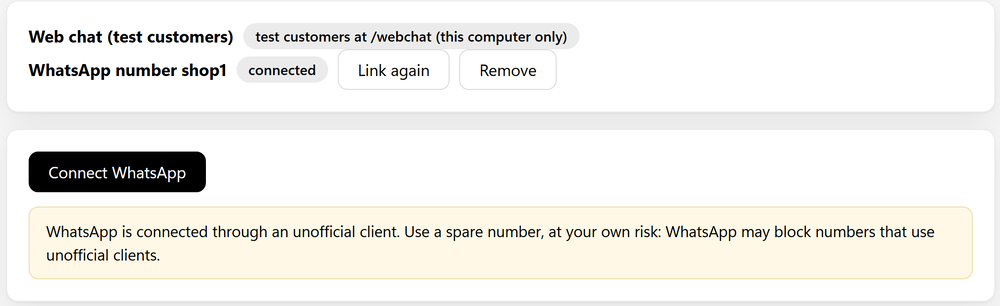

# Connect WhatsApp

Link a WhatsApp number to the shop by scanning a code with the phone, the same way you link WhatsApp Web.

> Use a spare number. OwnShop AI connects to WhatsApp through an unofficial client, not the official WhatsApp Business Platform. WhatsApp may block numbers that use unofficial clients. Do not link the number you cannot afford to lose.

## Before you start

- A phone with WhatsApp (or WhatsApp Business) on the spare number, with the internet on.
- The shop running on your computer, and the computer online.

## 1. Show the code

1. Open **Settings** and scroll to **Chat channels**, or go to setup step 4.
2. Click **Connect WhatsApp**.
3. A square code appears on the page. The page refreshes itself every few seconds while the code is shown, and the code changes; always scan the latest one.

## 2. Scan it with the phone

1. On the phone, open WhatsApp.
2. Go to **Settings** (on iPhone) or the three-dot menu (on Android), then **Linked devices**.
3. Tap **Link a device**. Unlock the phone if it asks.
4. Point the camera at the code on your computer screen.

## 3. Wait for connected

The row for the number first says "Linked. Finishing setup, this can take a minute...", then **connected**.

**connected** means the shop now reads new messages to that number and answers them. The phone keeps working as usual; you see the shop's replies in the chats on the phone too.

Numbers are named **shop1**, **shop2** and so on. You can link more than one number by clicking **Connect WhatsApp** again.

## Link again or remove

- **Link again** shows a new code for that number, for example after you removed the linked device on the phone.
- **Remove** unlinks that number from the shop. Orders and chats stay.

## What the shop sends on WhatsApp

- It only answers people who wrote first, plus updates on their own order.
- It pauses while "typing" and sends at most one message every 2 seconds per chat.
- It never broadcasts. A daily cap (200 messages per number by default) is under **Settings > Sending limits**.

## If it goes wrong

- **The code ran out before I scanned.** Wait for the page to refresh and scan the new code.
- **The status says "disconnected ... reconnecting in 10 seconds".** The computer or the phone lost the internet. It reconnects by itself; check the internet if it keeps showing.
- **The status says "not linked".** The device was removed on the phone. Click **Link again** and scan.
- **"not running: the WhatsApp helper (wacli) is not installed".** The install is incomplete. Install OwnShop AI again with the setup file.
- **The number was banned.** WhatsApp decided this, and OwnShop AI cannot undo it. Use another spare number, or use [Telegram](/manual/telegram/), which is official and free.
