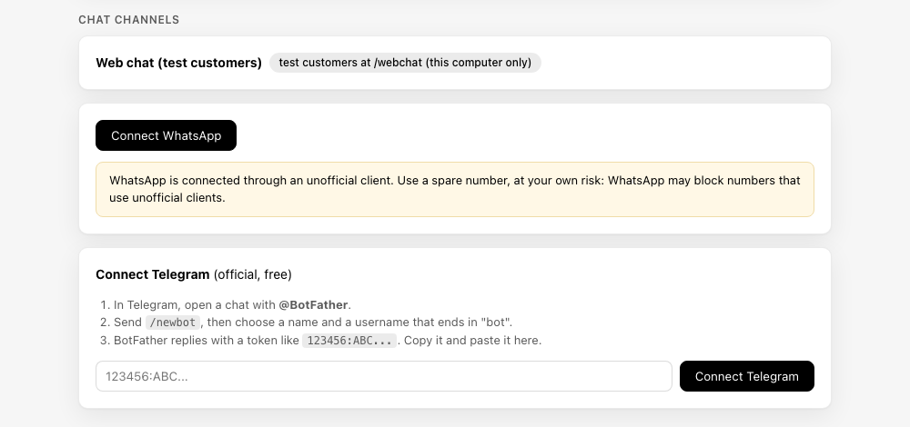

# Connect Telegram

Make a free Telegram bot with BotFather and paste its token into the shop. Telegram bots are official, so there is no ban risk as with WhatsApp.

## 1. Make the bot in Telegram

1. In Telegram, search for **@BotFather** (it has a blue check mark) and open the chat.
2. Send `/newbot`.
3. BotFather asks for a **name**. This is what customers see, for example `Green Leaf Organics`.
4. BotFather asks for a **username**. It must end in `bot`, for example `GreenLeafShopBot`. If it is taken, try another.
5. BotFather replies with a **token** that looks like `123456789:AAH...`. Copy it.

> Never share the token. Anyone with it can read and send your bot's messages. Do not post it in a chat, a screenshot or an email. If it leaks, send `/revoke` to BotFather to get a new one, then paste the new one into the shop.

## 2. Paste the token into the shop

1. Open **Settings** and scroll to **Chat channels**, or go to setup step 4.
2. Paste the token into the box under **Connect Telegram**.
3. Click **Connect Telegram**.

## What you should see

- A **Telegram bot** row in the channels list with its status.
- **Connected bot token:** with only the start of the token shown, and a **Remove** button.

Customers find your bot by its username in Telegram, or with a link `https://t.me/<username>`. Share that link on your shop sign, cards or website.

## If it goes wrong

- **The bot does not answer.** Check that the shop is running and the computer is online, and that you pasted the whole token.
- **I pasted the wrong token.** Click **Remove**, then paste the right one.
- **Someone else got the token.** Send `/revoke` to BotFather, then paste the new token.
