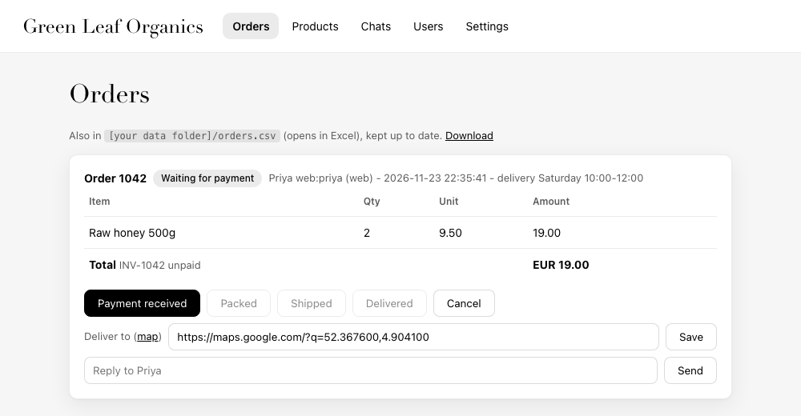
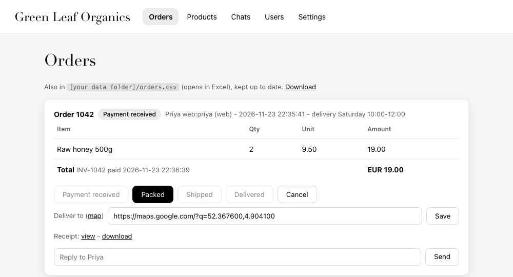
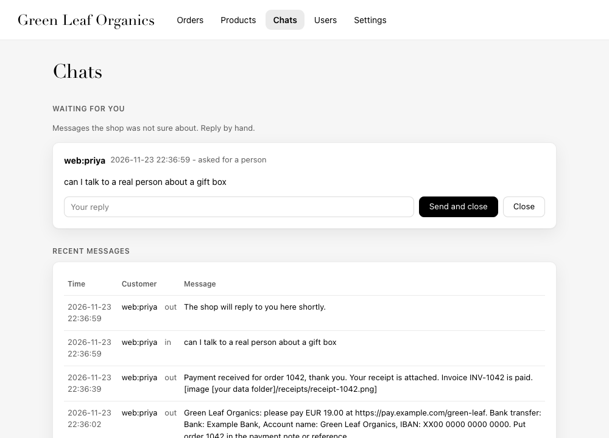

# Daily use

What to check each day: new orders, payments to confirm, messages the shop handed to you, and your customers.

## 1. Orders

Open **Orders**. The newest order is at the top. Each order shows:

- the order number and its status, for example **Waiting for payment**,
- the customer, the channel (whatsapp, telegram or web), when it was placed, and the delivery slot or booking time,
- the items, quantities, prices and the total, with the invoice number and whether it is paid,
- **Deliver to**: the address or map link the customer shared. You can type or correct it and click **Save**.

The same list is kept in `orders.csv` in your data folder (it opens in Excel) and is updated after every change. **Download** gives you a copy.

## 2. Move an order along

The buttons go in this order, and only the next one can be clicked:

1. **Payment received**: after you checked the money arrived. The customer gets a receipt.
2. **Packed**
3. **Shipped**
4. **Delivered**

Each click updates the status, and the customer is told. After a receipt is made, **Receipt: view - download** appears on the order.

**Cancel** stops the order. It asks you to confirm, puts the items back in stock, and tells the customer. Delivered or cancelled orders have no more buttons.

## 3. Reply to a customer about an order

Type in the **Reply to ...** box at the bottom of the order and click **Send**. The message goes to the customer on the channel they used.

## 4. Chats

**Chats** has two parts:

- **Waiting for you**: messages the shop was not sure about, or where the customer asked for a person. Type your answer and click **Send and close**, or **Close** to dismiss it without a reply. The customer was already told "The shop will reply to you here shortly."
- **Recent messages**: the latest messages in and out, on all channels.

Check **Waiting for you** a few times a day. The shop does not answer those messages for you.

## 5. Customers

The **Users** page lists everyone who wrote to the shop, with their channel and number of orders. See [Users and blocking](/manual/users/).

## What customers can ask without you

Greetings, the catalog, prices and stock, opening hours, your FAQ answers, how to pay, and the status of their own order are answered from your data. Ordering and booking work in chat. Anything else is handed to you on **Chats**.

## If it goes wrong

- **"order 1042 is ... it cannot move to ..."**: the order is already past that step, or cancelled.
- **A customer says they got no reply.** Check that the shop is running, the channel says **connected** in **Settings**, and the customer is not blocked on **Users**.
- **Waiting for you keeps filling up.** Add the missing answers to the FAQ sheet of your products file, with good keywords. See [Add products from Excel](/manual/products-excel/).
