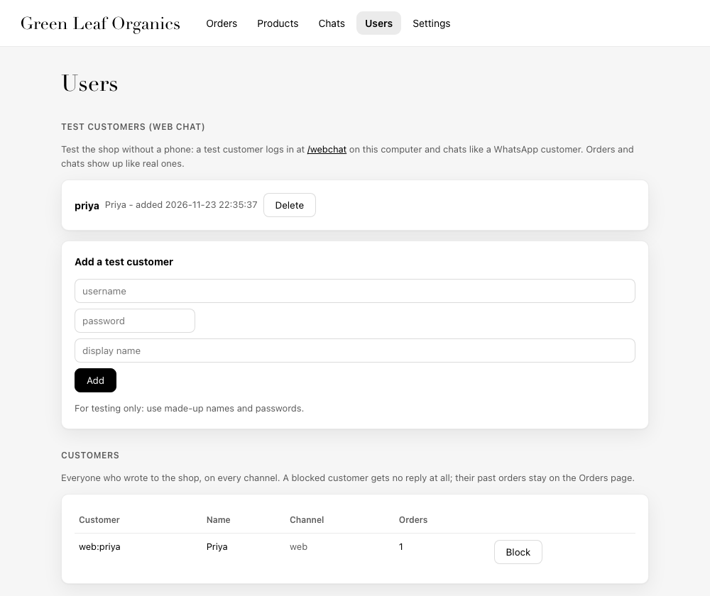

# Users and blocking

The Users page has test customers for the web chat, and the list of real customers with a Block button.

## 1. Add a test customer

Test customers can log in to the web chat on this computer and order like a real customer.

1. Open **Users**.
2. Under **Add a test customer**, type a **username** (for example `priya`), a **password** (for example `demo123`) and a **display name** (for example `Priya`).
3. Click **Add**. The test customer appears in the list above.

Use made-up names and passwords. These are for testing only. **Delete** removes a test customer.

To chat as that customer, see [Test without a phone](/manual/test-without-phone/).

## 2. Block a customer

The **Customers** list shows everyone who wrote to the shop, on every channel: WhatsApp numbers, Telegram users and web chat test customers.

1. Find the customer in the list.
2. Click **Block**. The row shows **blocked**.

A blocked customer gets no reply at all, on any channel. Their past orders stay on the Orders page.

## 3. Unblock

Click **Unblock** on that row. The shop answers them again from their next message.

## If it goes wrong

- **The customer is not in the list.** They appear after their first message reaches the shop.
- **A test customer cannot log in.** Check the username and password, or delete and add them again. Test customers are removed by **Delete this shop and start a new one**.
