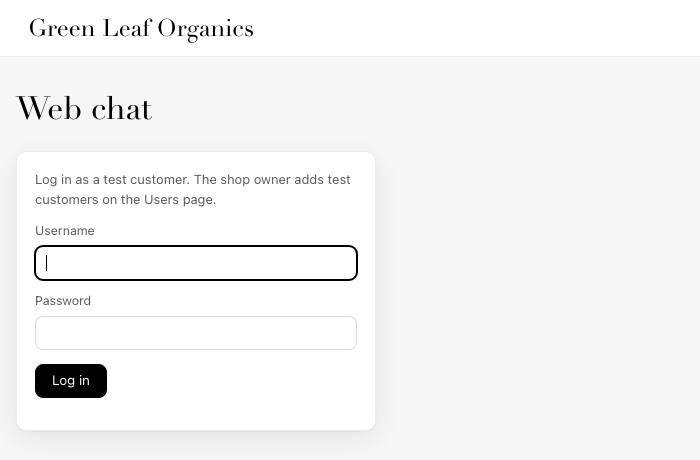
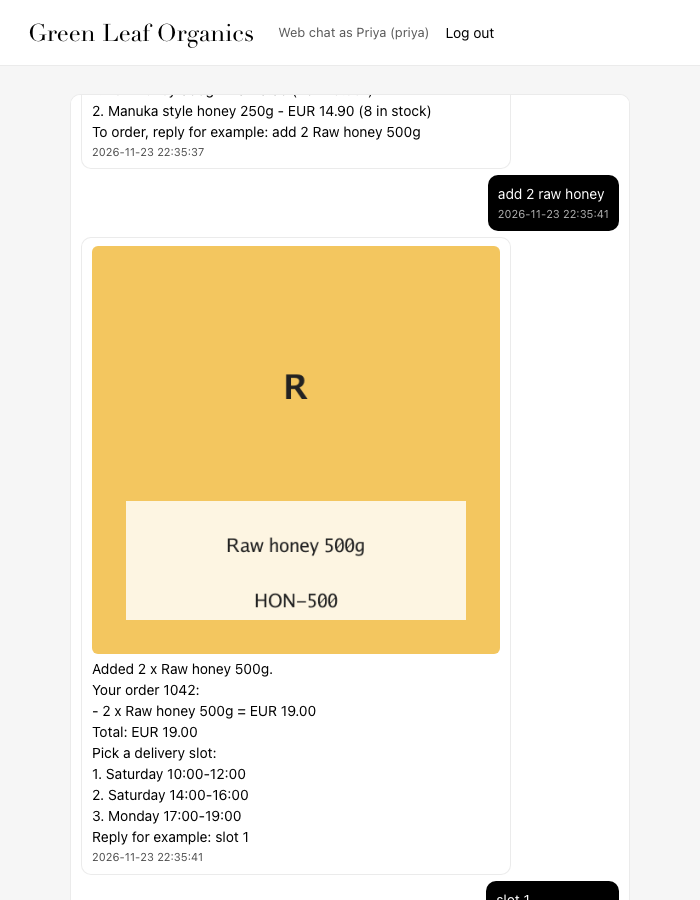
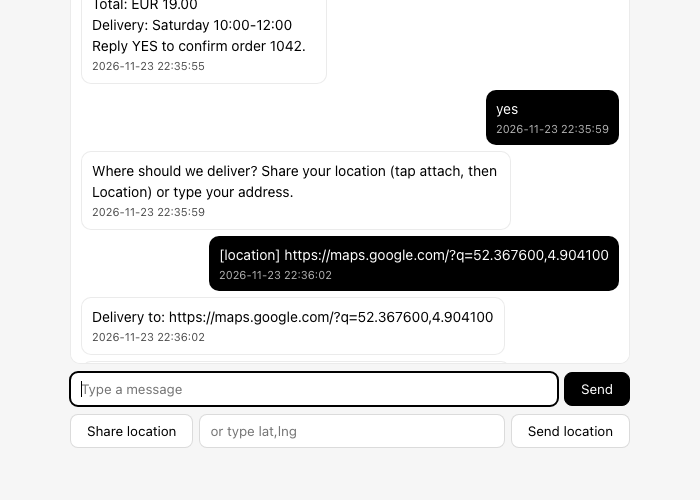

# Test without a phone

Try your shop as a customer before anyone else does: in the browser with the web chat, or from the command line.

## 1. The web chat

1. Add a test customer on **Users** (see [Users and blocking](/manual/users/)).
2. On the same computer, open `http://localhost:2007/webchat`.
3. Log in with the test customer's email or phone and password. New here? Type a new email or phone and a password: that creates the test login.



The web chat only works on the computer the shop runs on. It is the same bot your WhatsApp and Telegram customers talk to, and its orders and chats show up on your pages like real ones.

## 2. Place a test order

Type these one at a time and press **Send**:

1. `do you have honey`: the shop lists matching products with a photo.
2. `add 2 raw honey`: it builds the order and asks for a delivery slot.
3. `slot 1`: it shows the order and asks you to confirm.
4. `yes`: it asks where to deliver.
5. Share a location: **Share location** uses the browser's location, or type it as `lat,lng` (for example `52.3676,4.9041`) and click **Send location**. You can also type an address.



Then the shop sends the invoice and how to pay. Open **Orders** to see the new order and try **Payment received**.



Use your own product names; these steps use the example file. For a services shop, try `book Haircut` (or your service).

## 3. From the command line

For people who like a terminal. The program is:

- Windows: `%LOCALAPPDATA%\ownshop\ownshop.exe`
- Mac: `"/Applications/OwnShop AI.app/Contents/MacOS/ownshop"` (or under `~/Applications`)

The program is not on your PATH, so type its full path in place of `ownshop` below, in quotes.

**Chat as a test customer** with the running shop. It prints each reply, stops when the shop has been quiet for 3 seconds, and gives up after 60 seconds:

```bat
ownshop say --user priya@example.com --password demo123 "do you have honey"
ownshop say --user priya@example.com --password demo123 --location 52.3676,4.9041
```

Add `--url http://localhost:2008` if the shop runs on another port.

**Test customers and blocking.** These commands work on the shop's database file. Without `--db` they use `ownshop.db` in the current folder, so either go to the data folder first or pass `--db`:

```bat
cd /d "%APPDATA%\ownshop"
ownshop webuser add priya@example.com demo123 --name Priya
ownshop webuser list
ownshop webuser delete priya@example.com
ownshop user list
ownshop user block web:priya@example.com
ownshop user unblock web:priya@example.com
```

On a Mac the data folder is `~/Library/Application Support/ownshop`, for example `--db ~/Library/Application\ Support/ownshop/ownshop.db`.

`ownshop` without a command does the same as a double-click.

## When you are done testing

Remove the test orders and chats with **Clear test data**. See [Start over](/manual/start-over/).

## If it goes wrong

- **"web chat is served on this computer only"**: open the web chat on the computer the shop runs on, with `localhost` or `127.0.0.1` in the address.
- **"wrong username or password" or "the password does not match"**: check the test customer on **Users**.
- **The first answer takes long.** The AI model is loading. See [Troubleshooting](/manual/troubleshooting/).
