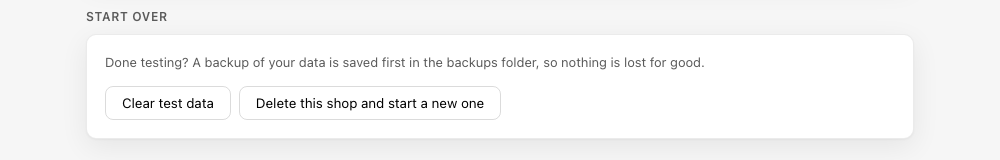
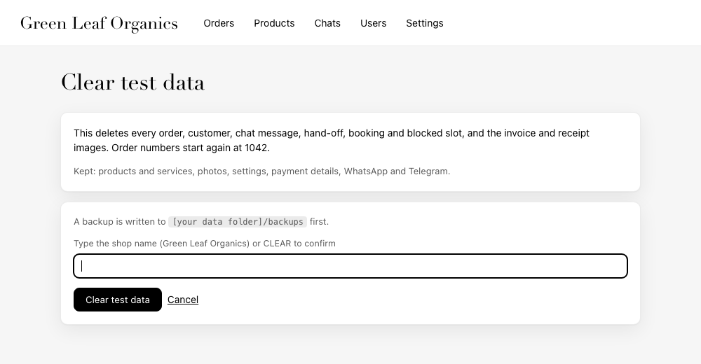
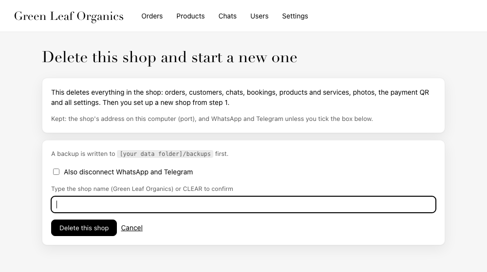

# Start over

Two ways to start fresh: clear the test orders and chats and keep the shop, or delete the whole shop and set up a new one. Both save a backup first.

Find both in **Settings** under **Start over**, or click **Start over** at the bottom of any page.

## Clear test data

Use this after testing, before real customers come.

1. Click **Clear test data**.
2. Read what it deletes: every order, customer, chat message, hand-off, booking and blocked slot, and the invoice and receipt images. Order numbers start again at 1042.
3. Type the shop name, or `CLEAR`, in the box.
4. Click **Clear test data**.

**Kept:** products and services, photos, settings, payment details, WhatsApp and Telegram. Test customers for the web chat are kept too.

## Delete this shop and start a new one

Use this to set up a different shop from step 1.

1. Click **Delete this shop and start a new one**.
2. Read what it deletes: orders, customers, chats, bookings, products and services, photos, the payment QR and all settings, including the test customers.
3. Leave **Also disconnect WhatsApp and Telegram** unticked to keep them connected, or tick it to disconnect them.
4. Type the shop name, or `CLEAR`, and click **Delete this shop**.
5. Setup step 1 opens.

**Kept:** the shop's address on this computer (the port), and WhatsApp and Telegram unless you ticked the box.

## The backups folder

Before either action, the shop writes a backup to the `backups` folder inside your data folder, in a new folder named by date and time, for example `backups\20261123-223712`. It holds:

- `ownshop.db`: the shop's database (orders, customers, chats, settings),
- `products.xlsx`: your products file.

Photos, invoice and receipt images are not in the backup. Copy the `images` folder yourself first if you need them.

The page says where the backup went, for example "Test orders, customers and chats are cleared. Backup: ...".

## If it goes wrong

- **"Nothing was changed: type the shop name or CLEAR to confirm."** The text did not match. Type `CLEAR` in capitals, or the shop name exactly.
- **I need the old data back.** The backup is a copy, not an undo button. Stop the shop, copy `ownshop.db` and `products.xlsx` from the backup folder back into the data folder, and start the shop again. Keep a copy of the current files first.
